## FreeBSDのVMへのinstall方法

今回は、QEMU/KVMを使ってFreeBSDをVMにインストールする。

### VMの準備

まず、FreeBSDに割り当てるリソースを決める。

* **vCPU:** 2
* **RAM:** 2 GiB
* **ディスク:** 16 GiB
* **ネットワーク:** VirtIO
* **UEFI:** 使用

FreeBSD自体は1 CPUでも動作するが、パッケージのインストールやコンパイル、デスクトップ環境の使用などを考えると、2 CPU程度あると使いやすい。

メモリは2 GiBとする。GUIを動かす場合は4 GiB程度にするとさらに快適。

ディスクは16 GiBあれば、「ちょっとFreeBSDを触ってみる」という用途には十分。

ネットワークにはVirtIOを使用する。

今回はUEFI環境でVMを構築するため、VM側もUEFIで起動させる。

---

### KVMが使えるか確認する

まず、KVMが利用できるか確認する。

```bash
ls -l /dev/kvm
```

```text
crw-rw----+ 1 root kvm 10, 232  8月 22 16:37 /dev/kvm
```

`/dev/kvm`が存在し、現在のユーザーからアクセスできれば、QEMUでKVMによるハードウェアアクセラレーションを利用できる。

続いてQEMUと必要なパッケージをインストールする。

```bash
sudo apt update
sudo apt upgrade
sudo apt install qemu-system-x86 qemu-utils ovmf
```

インストールされたことを確認する。

```bash
qemu-system-x86_64 --version
```

```text
QEMU emulator version 10.0.11 (Debian 1:10.0.11+ds-0+deb13u1)
Copyright (c) 2003-2025 Fabrice Bellard and the QEMU Project developers
```

---

### VM用のディレクトリを作成

VMに必要なファイルをまとめるため、ディレクトリを作成する。

```bash
mkdir -p ~/vm/freebsd
cd ~/vm/freebsd
```

---

### 仮想ディスクを作成

16 GiBのqcow2形式の仮想ディスクを作成する。

```bash
qemu-img create -f qcow2 freebsd.qcow2 16G
```

```text
Formatting 'freebsd.qcow2', fmt=qcow2 cluster_size=65536 extended_l2=off compression_type=zlib size=17179869184 lazy_refcounts=off refcount_bits=16
```

作成直後は実際にはほとんどデータが入っていないため、ファイルサイズは小さい。

```bash
tree
```

```text
.
└── freebsd.qcow2

1 directory, 1 file
```

`qemu-img info`でも確認できる。

```bash
qemu-img info freebsd.qcow2
```

```text
image: freebsd.qcow2
file format: qcow2
virtual size: 16 GiB (17179869184 bytes)
disk size: 196 KiB
cluster_size: 65536
Format specific information:
    compat: 1.1
    compression type: zlib
    lazy refcounts: false
    refcount bits: 16
    corrupt: false
    extended l2: false
Child node '/file':
    filename: freebsd.qcow2
    protocol type: file
    file length: 192 KiB (197120 bytes)
    disk size: 196 KiB
```

`virtual size`が16 GiBになっているので、16 GiBの仮想ディスクが作成できている。

---

### FreeBSDのISOを取得

次にFreeBSDのインストールISOを取得する。

今回は`amd64`版のインストーラISOを使用する。

```bash
wget https://download.freebsd.org/releases/amd64/amd64/ISO-IMAGES/15.1/FreeBSD-15.1-RELEASE-amd64-disc1.iso
```

ダウンロードが完了したら確認する。

```bash
ls -lh
```

```text
合計 1.3G
-rw-rw-r-- 1 ceesta ceesta 1.3G  6月 12 21:30 FreeBSD-15.1-RELEASE-amd64-disc1.iso
-rw-r--r-- 1 ceesta ceesta 193K  8月 26 12:08 freebsd.qcow2
```

ISOの取得が完了した。

ダウンロードしたISOは、必要に応じてFreeBSD公式サイトに掲載されているチェックサムと比較し、ファイルが正しく取得できていることを確認できる。

例えばSHA256を計算する場合は、

```bash
sha256sum FreeBSD-15.1-RELEASE-amd64-disc1.iso
```

とする。

---

### OVMFを確認

今回はUEFIでVMを起動するため、OVMFを使用する。

まず、OVMFのファイルを確認する。

```bash
ls /usr/share/OVMF/
```

```text
OVMF_CODE_4M.fd          OVMF_CODE_4M.secboot.strictnx.fd OVMF_VARS_4M.ms.fd
OVMF_CODE_4M.ms.fd       OVMF_CODE_4M.snakeoil.fd         OVMF_VARS_4M.fd
OVMF_CODE_4M.secboot.fd  OVMF_VARS_4M.fd
```

今回は以下の2つを使用する。

```text
/usr/share/OVMF/OVMF_CODE_4M.fd
/usr/share/OVMF/OVMF_VARS_4M.fd
```

`OVMF_VARS_4M.fd`はVMごとに保存して使用する。

```bash
cp /usr/share/OVMF/OVMF_VARS_4M.fd ./OVMF_VARS_4M.fd
```

---

### 初回起動前の確認

VM用ディレクトリの中身を確認する。

```bash
cd ~/vm/freebsd
ls -lh
```

```text
-rw-rw-r-- 1 ceesta ceesta 1.3G  6月 12 21:30 FreeBSD-15.1-RELEASE-amd64-disc1.iso
-rw-r--r-- 1 ceesta ceesta 528K  8月 26 12:27 OVMF_VARS_4M.fd
-rw-r--r-- 1 ceesta ceesta 193K  8月 26 12:08 freebsd.qcow2
```

この3つのファイルがあれば、VMを起動できる。

---

### VMを起動

以下のコマンドでVMを起動する。

```bash
qemu-system-x86_64 \
  -enable-kvm \
  -cpu host \
  -smp 2 \
  -m 2G \
  -drive file=freebsd.qcow2,if=virtio,format=qcow2 \
  -cdrom FreeBSD-15.1-RELEASE-amd64-disc1.iso \
  -boot order=d \
  -nic user,model=virtio \
  -drive if=pflash,format=raw,readonly=on,file=/usr/share/OVMF/OVMF_CODE_4M.fd \
  -drive if=pflash,format=raw,file=OVMF_VARS_4M.fd
```

ネットワークバックエンドにはQEMUのUser Networkingを使用し、ゲスト側の仮想NICにはVirtIOを使用している。

起動するとFreeBSDのブートメニューが表示される。

何も操作しなければ、自動的に`1. BootInstaller`が選択され、インストーラが起動する。

スペースキーを押すと自動選択を止めることができる。

今回はインストールするので、そのまま`1. BootInstaller`で進める。


---

## FreeBSDのインストール

FreeBSDのインストーラでは、基本的にキーボードで操作する。

* **矢印キー**：項目を移動
* **Space**：項目を選択・解除
* **Enter**：決定
* **Tab**：別のボタンや入力欄へ移動

### インストールを選択

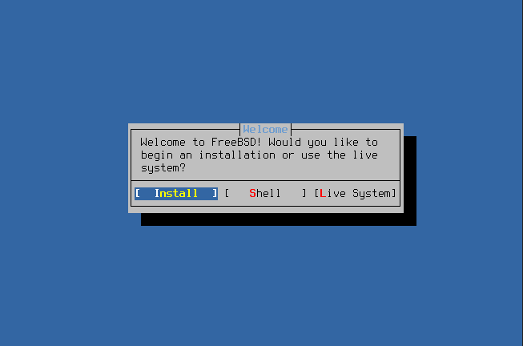

`Install`を選択する。

### キーマップを選択

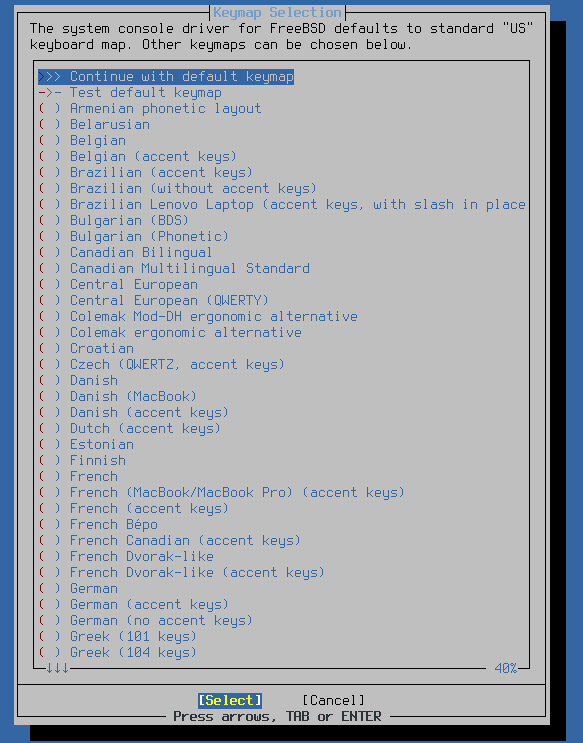

キーマップを選択する。

今回は日本語キーボードなので、`Japanese 106`を選択する。

### キーボードを確認

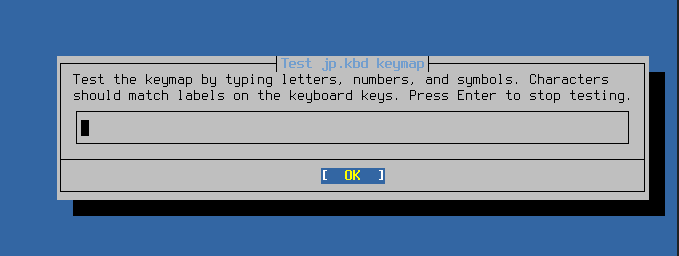

選択したキーマップが正しいか確認する。

Shiftキーを押しながら`1 2 3`を入力して、

```text
! " #
```

となれば、JP106キーボードとして正しく認識されている。

確認できたら、`>>> Continue with jp.kbd keymap`を選択する。

### ホスト名を設定

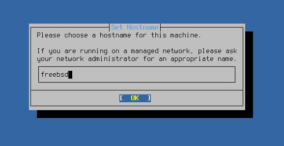

ホスト名を入力する。

ここは自由に決めてよい。

今回はVMなので、分かりやすく`freebsd`とする。

### システムのインストール方式を選択

FreeBSDの基本システムを、従来の「Distribution Sets」方式でインストールするか、ベースシステムをパッケージとしてインストールするかを選択する。

FreeBSD 15.1では、`Distribution Sets`と`Packages`の2つの方式が用意されている。

`Distribution Sets`は従来から使用されている方式で、`base.txz`や`kernel.txz`などの配布セットから基本システムをインストールする。

一方、`Packages`ではベースシステムをパッケージとして取得・インストールする。これはFreeBSDのベースシステムをパッケージとして管理する`pkgbase`の仕組みを利用する。

今回はインストーラのデフォルト設定を基本的に採用するため、最初から選択されている`Packages`を使用する。

### パッケージの取得方法を選択

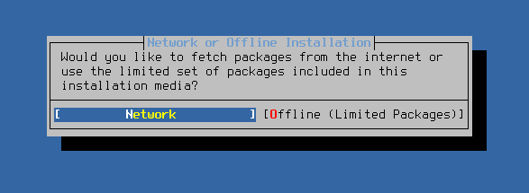

パッケージをネットワークから取得するか、インストールメディアに含まれているものだけを使用するかを選択する。

今回はネットワークに接続しているので、`Network`を選択する。

### ネットワークインターフェースを設定

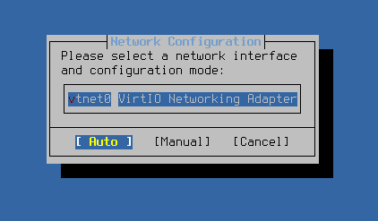

ネットワークインターフェースとネットワーク設定の方法を選択する。

VirtIOで作成したネットワークインターフェースは`vtnet0`として認識されている。

今回は`vtnet0`を選択し、設定方法は`Auto`のまま進める。

画面が遷移するが、しばらく待つとネットワーク設定が完了する。

今回は10秒もかからなかった。

---

## パーティションを設定

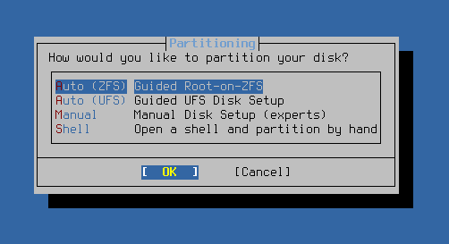

FreeBSDをどのようにディスクへインストールするか設定する。

今回はVMなので、仮想ディスク全体をFreeBSD用として使用する。

実機にインストールする場合は、既存のデータを消してしまう可能性があるため、特に注意が必要な画面。

今回は、

```text
Auto (ZFS) Guided Root-on-ZFS
Auto (UFS) Guided UFS Disk Setup
```

の中から`Auto (UFS) Guided UFS Disk Setup`を選択する。

今回は2 GiBの小さなVMであり、シンプルな構成にしたいため、ファイルシステムにはUFSを使用する。

最初はZFSが選択されていたので、UFSに変更する。

### ディスク全体を使用する

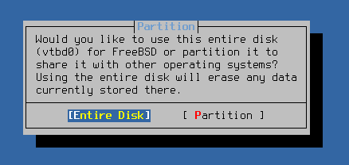

ディスク全体をFreeBSDの領域として使用してよいか確認される。

今回はVM用に作成した16 GiBの仮想ディスクなので、`Entire Disk`を選択して問題ない。

ただし、実機でデュアルブートを行っている場合など、ディスク上に別のOSやデータが存在する場合は注意する。

### パーティション方式を選択

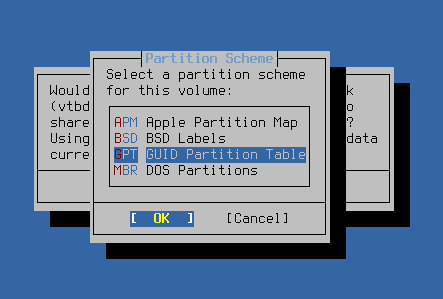

今回はUEFIで起動するVMとして作成しているため、`GPT`を選択する。

### パーティション構成を確認

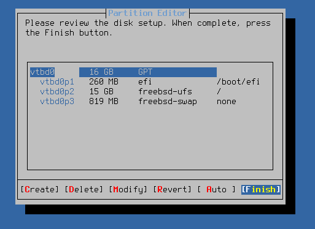

作成されるパーティションを確認する。

```text
vtbd0p1    260 MB     EFI System Partition
vtbd0p2    約15 GB    FreeBSD本体（UFS）
vtbd0p3    819 MB     swap
```

問題なければ、そのまま`Finish`を選択する。

### ディスクへの書き込みを確定

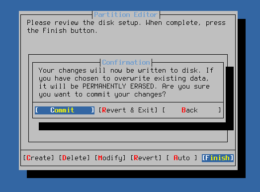

最後に、実際にディスクの内容を変更してよいか確認される。

`Commit`を選択すると、パーティションの作成やファイルシステムの作成が実際に行われる。

今回はVMなので、変更されるのは作成した仮想ディスクだけで、ホストPCの実ディスクには影響しない。

ここがディスク構成を変更する前の最終確認になる。

`Commit`を選択すると処理が始まる。

下の方にいろいろな処理が表示されるが、しばらく待てば完了する。

今回は3秒ほどで完了した。

### 追加パッケージを選択

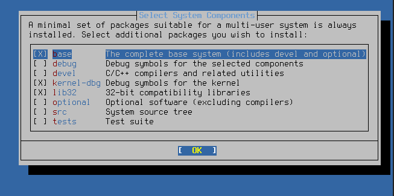

追加でインストールするパッケージを選択する。

今回はデフォルトのまま、追加選択なしで進める。

必要なパッケージは、FreeBSDのインストール後に自分で追加できるので、ここでは気軽に進めてよい。

### インストールを待つ

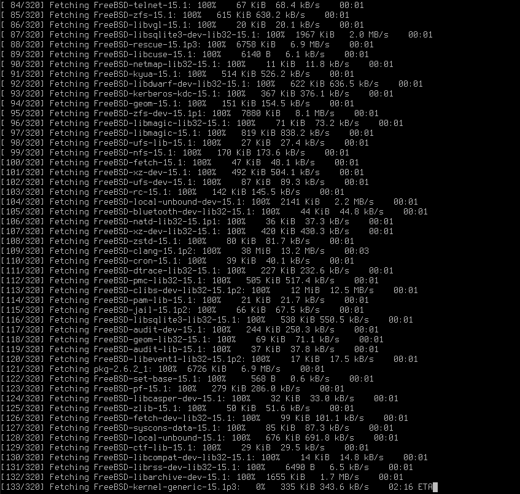

しばらく待つ。

### rootパスワードを設定

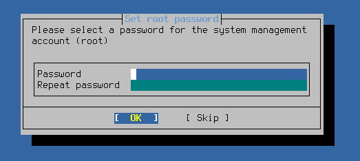

rootユーザーのパスワードを設定する。

設定したパスワードは忘れないようにする。

### タイムゾーンを設定

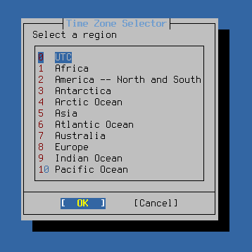

タイムゾーンを設定する。

今回は日本に設定する。

まず`5 Asia`を選択する。

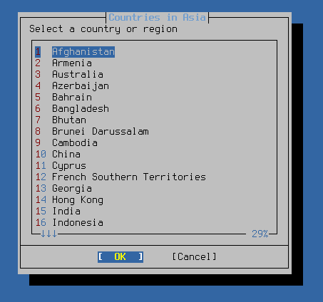

次に`20 Japan`を選択する。


確認画面が表示される。

日本で問題なければ、そのまま`Yes`を選択する。

### 日付を設定

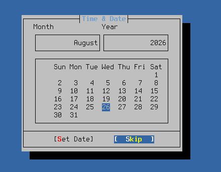

日付の設定を行う。

今回はネットワークに接続されているため、自動的に正しい日付が認識されている。

変更せずに`Skip`を選択する。

### 時刻を設定

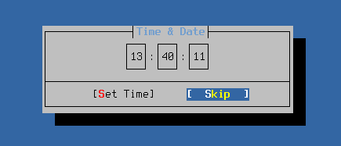

続いて時刻を設定する。

こちらも自動的に正しい時刻が認識されているので、変更せずに`Skip`を選択する。

### 起動時に自動起動するサービスを選択

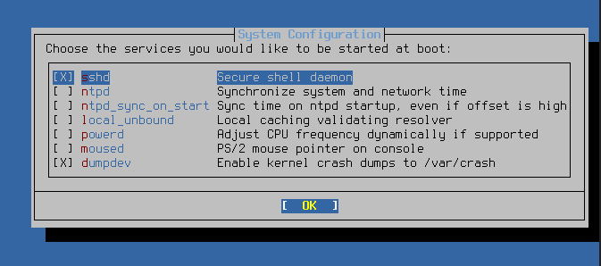

FreeBSDの起動時に自動的に起動するサービスを選択する。

これらのサービスはインストール後に設定することもできるので、基本的にはデフォルトのままでよい。

ただし、SSHでVMへ接続したい場合は`sshd`を有効にしておくと便利。

`sshd`を有効にすると、FreeBSDのIPアドレスを使って、

```bash
ssh ユーザー名@FreeBSDのIPアドレス
```

のようにSSH接続できる。

そのため、今回は`sshd`にチェックを入れておく。

### セキュリティ設定

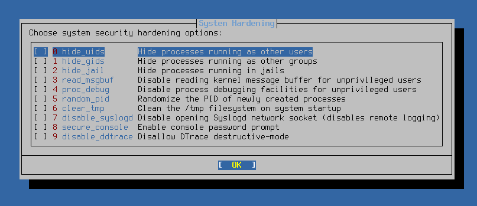

追加のセキュリティ強化について設定する。

今回は基本的なFreeBSDのインストールを目的としているので、すべてデフォルト、つまり未選択のまま`OK`で進める。

必要になった場合は、インストール後に設定できる。

また画面が遷移するので、しばらく待つ。

今回は5秒ほどで完了した。

---

## 一般ユーザーを追加

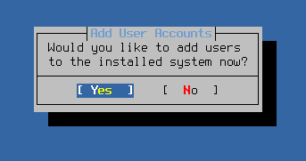

一般ユーザーを追加する。

ユーザーを追加しない場合、基本的にrootユーザーですべての操作を行うことになる。

普段使いするのであれば一般ユーザーを作成したほうがよいので、今回は追加する。

### ユーザー名とパスワードを設定

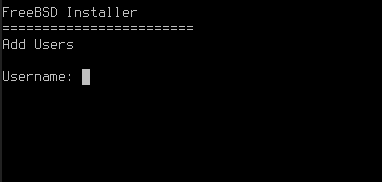

ユーザー名とパスワードを入力する。

### ユーザーの設定

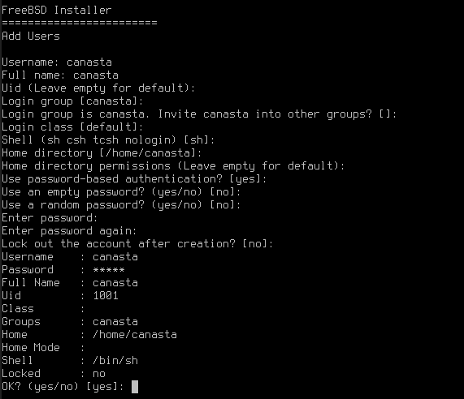

ユーザーに関する追加設定を行う。

今回は特に変更する必要がないため、すべてデフォルトのまま`Enter`で進める。

### 設定を確認

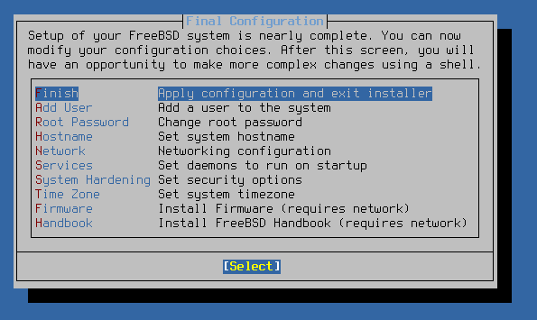

最後に、ここまで設定した内容を確認する。

問題がなければ、そのまま`Finish`を選択する。

今後、細かい設定はFreeBSDを起動した後にShellから変更していくことになる。

### Shellを起動するか

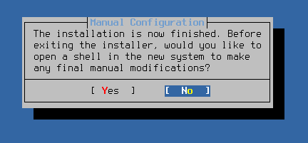

インストーラのShellを起動するか聞かれる。

今回は必要ないので`No`を選択する。

### 再起動

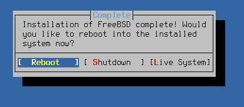

インストールが完了したので、再起動する。

デフォルトで再起動が選択されているので、そのまま進める。

---

## FreeBSDの起動

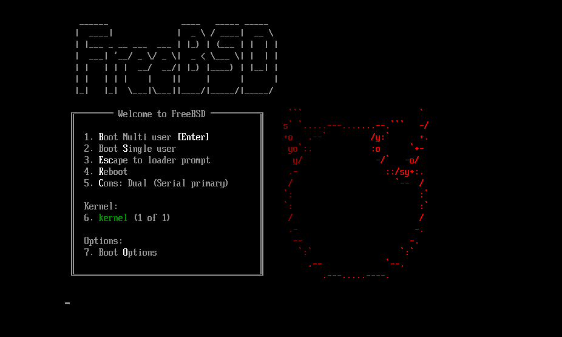

最初に表示されていたインストーラの画面が消え、FreeBSDがインストールされた。

これでFreeBSDのインストールは完了。

記念に起動画面のスクリーンショットを撮りたい場合は、スペースキーを押して自動選択を停止するとよい。

FreeBSDを通常起動するには、

```text
1. Boot Multi user
```

を選択する。1またはEnterを押す。

これで、先ほど作成したFreeBSDのシステムが起動する。

---

## インストール後の確認

FreeBSDが起動したら、作成した一般ユーザーでログインする。

まず、FreeBSDのバージョンを確認する。

```bash
freebsd-version
```

ネットワークが利用できることも確認する。

```bash
ping -c 3 google.com
```

これで、QEMU/KVM上へのFreeBSDの基本的なインストールとネットワーク設定は完了した。

---

### インストール後の再起動

インストールが完了した後は、インストール用ISOを使わずにFreeBSDを起動できる。

初回起動時には、インストールISOから起動するために、

```bash
-cdrom FreeBSD-15.1-RELEASE-amd64-disc1.iso
-boot order=d
```

を指定していた。

インストールが完了した後は、この2つを外して起動する。

```bash
cd ~/vm/freebsd

qemu-system-x86_64 \
  -enable-kvm \
  -cpu host \
  -smp 2 \
  -m 2G \
  -drive file=freebsd.qcow2,if=virtio,format=qcow2 \
  -nic user,model=virtio \
  -drive if=pflash,format=raw,readonly=on,file=/usr/share/OVMF/OVMF_CODE_4M.fd \
  -drive if=pflash,format=raw,file=OVMF_VARS_4M.fd
```

これで、ISOではなく仮想ディスクにインストールしたFreeBSDが起動する。

起動するまでの流れは、

```text
OVMF (UEFI)
   ↓
freebsd.qcow2
   ↓
FreeBSD
```

となる。

`-cdrom`を指定していないためインストールISOは接続されず、`-boot order=d`も指定していないため、UEFIから仮想ディスク上のFreeBSDを起動する。

以降、VMを終了した後に再びFreeBSDを起動するときも、基本的にはこのコマンドを使用すればよい。

なお、VMをシャットダウンした場合は、QEMU自体も終了しているため、同じコマンドをもう一度実行することでVMを起動できる。

### 起動コマンドをスクリプト化する

毎回この長いQEMUコマンドを入力するのは面倒なので、最終的には起動用のスクリプトを作っておくと便利。

VMのディレクトリに`freebsd-start.sh`を作成する。

```bash
#!/bin/sh

qemu-system-x86_64 \
  -enable-kvm \
  -cpu host \
  -smp 2 \
  -m 2G \
  -drive file=freebsd.qcow2,if=virtio,format=qcow2 \
  -nic user,model=virtio \
  -drive if=pflash,format=raw,readonly=on,file=/usr/share/OVMF/OVMF_CODE_4M.fd \
  -drive if=pflash,format=raw,file=OVMF_VARS_4M.fd
```

実行権限を付与する。

```bash
chmod +x freebsd-start.sh
```

あとはVMのディレクトリで、

```bash
./freebsd-start.sh
```

と実行するだけでFreeBSDを起動できる。

これで、FreeBSDを使いたいときは、

```bash
cd ~/vm/freebsd
./freebsd-start.sh
```

だけで起動できるようになる。

VMを終了した後も、同じスクリプトを実行すれば再びFreeBSDを起動できる。
